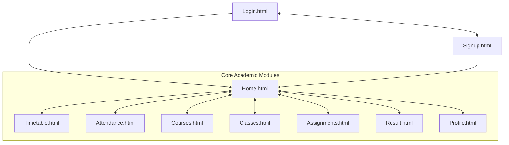

# Practical-01: StudentHub Portal Initiation & Architecture Planning

**Student Name:** Jay Zalavadiya  
**Student ID:** 25CE142  
**Subject:** Web Development Frameworks (ITUE203)  
**Department:** Computer Engineering (CSPIT-CE)  
**University:** CHARUSAT  

---

## 1. Aim
Initiate the semester-long **StudentHub** portal by identifying the problem scope, user roles, key modules, navigation flow, and minimum 10 pages. Create a sitemap, low-fidelity wireframe, project folder structure, README file, and GitHub repository.

**Tools / Technology to be Used:** VS Code, Draw.io, Git & GitHub.

---

## 2. Core Concepts & Requirement Analysis

### 2.1 Problem Scope
Colleges and universities often maintain disparate, fragmented systems for attendance, assignment submissions, course management, exam schedules, and results. This fragmentation leads to user confusion, redundant logins, and communication delays. 

**StudentHub** is conceptualized as a unified, centralized web portal designed for higher education institutes to streamline academic workflows for students, faculty, and administrative staff through an intuitive, accessible interface.

### 2.2 User Roles
1. **Student**:
   - Access course registrations and syllabi.
   - View weekly lecture timetables and track daily subject attendance.
   - Download assignments, view due dates, and submit lab work.
   - Check semester exam marks and grade reports.
2. **Faculty**:
   - Post lecture schedules, class notices, and assignments.
   - Mark and update student attendance records.
   - Grade submitted assignments and publish performance remarks.
3. **Administrator**:
   - Manage student and faculty master records.
   - Schedule academic events, seminars, and hackathons.
   - Oversee portal security, user privileges, and system metrics.

---

## 3. Minimum 10 Portal Pages & Key Modules

| No. | Page Filename | Module | Description |
|:---:|:---|:---|:---|
| 1 | `Login.html` | Authentication | Secure sign-in portal for registered students and faculty with role selection. |
| 2 | `Signup.html` | Registration | New user onboarding form capturing student ID, branch, email, and password. |
| 3 | `Home.html` | Central Hub | Main landing dashboard displaying navigation bar, welcome banner, and quick action cards. |
| 4 | `Timetable.html` | Academics | Weekly grid timetable showing lecture timings, classroom venues, and faculty names. |
| 5 | `Attendance.html` | Academics | Subject-wise attendance tracking percentage, lectures conducted, and eligibility status. |
| 6 | `Courses.html` | Curriculum | Detailed list of enrolled courses with credit points, instructor info, and syllabus links. |
| 7 | `Classes.html` | Academic Rooms | Classroom schedule, lab batch allocations, and live lecture meeting links. |
| 8 | `Assignments.html`| Evaluation | Assignment submission tracker with deadlines, submission status, and upload options. |
| 9 | `Result.html` | Performance | Semester grade card displaying course codes, credits, earned grade points, and SGPA/CGPA. |
| 10 | `Profile.html` | User Account | Student personal profile with contact information, academic year, and enrolled department. |

---

## 4. Sitemap & Navigation Flow



---

## 5. Low-Fidelity Wireframes

### 5.1 Login Page (`Login.html`)
```text
+-----------------------------------------------------------+
|                        StudentHub                         |
+-----------------------------------------------------------+
|                                                           |
|             +-------------------------------+             |
|             |             Login             |             |
|             +-------------------------------+             |
|             | Email:                        |             |
|             | [ student@example.com       ] |             |
|             |                               |             |
|             | Password:                     |             |
|             | [ ********************      ] |             |
|             |                               |             |
|             | [ Sign In Button            ] |             |
|             |                               |             |
|             | <a href="#">Forgot Password?</a>|             |
|             | Don't have an account? Sign Up|             |
|             +-------------------------------+             |
|                                                           |
+-----------------------------------------------------------+
```

### 5.2 Home Portal (`Home.html`)
```text
+-----------------------------------------------------------+
| StudentHub  |  Home | Timetable | Attendance | Courses | Results | Logout |
+-----------------------------------------------------------+
| Banner: Welcome to StudentHub Academic Portal             |
+-----------------------------------------------------------+
| Quick Links:                                              |
| [ View Timetable ]  [ Check Attendance ]  [ Submit Labs ] |
|                                                           |
| Latest Notices:                                           |
| • Mid-term examinations commence from next Monday.        |
| • Practical journal submission deadline: end of term.     |
+-----------------------------------------------------------+
| Footer: (c) 2026 StudentHub • CHARUSAT University         |
+-----------------------------------------------------------+
```

---

## 6. Project Folder Structure

```text
StudentHub/
├── css/
│   └── styles.css
├── js/
│   └── script.js
├── data/
│   ├── students.json
│   └── events.json
├── images/
│   └── logo.png
├── index.html
├── Login.html
├── Signup.html
├── Home.html
├── Timetable.html
├── Attendance.html
├── Courses.html
├── Classes.html
├── Assignments.html
├── Result.html
├── README.md
└── .gitignore
```

---

## 7. Version Control & Git Strategy
1. **Repository Initialization**: `git init`
2. **Atomic Commits**: Commit changes after every practical milestone with descriptive messages:
   - `git add .`
   - `git commit -m "Implement Practical-X: <feature description>"`
3. **Branching**: Develop features on feature branches when working collaboratively, merging cleanly into `main`.
4. **Remote Mirroring**: Maintain sync with GitHub remote via `git push -u origin main`.

---

## 8. Questions & Answers

1. **What is a URL and what are its parts?**  
   A Uniform Resource Locator (URL) is the global address used to locate resources on the Internet. Its primary components are:
   - **Protocol**: `https://` (specifies communication protocol)
   - **Domain / Hostname**: `charusat.edu.in` (specifies server)
   - **Port**: `:443` (optional standard port)
   - **Path**: `/studenthub/home.html` (hierarchical path to resource on server)
   - **Query String**: `?id=25CE142` (key-value parameters)
   - **Anchor/Fragment**: `#notices` (section pointer within the page)

2. **How is an HTML file processed in a web browser?**  
   The browser sends an HTTP request and receives raw bytes from the server. The HTML parser converts bytes to characters, then tokens, nodes, and constructs the **Document Object Model (DOM)** tree. Concurrently, CSS is parsed into the **CSSOM** tree. The DOM and CSSOM combine into a **Render Tree**, followed by **Layout** (calculating geometry) and **Painting** (rasterizing pixels onto the display).

3. **How will page navigation flow be managed among all HTML pages?**  
   Navigation is implemented via standard semantic HTML `<a>` anchor tags arranged in a shared `<header>` and `<nav>` bar across all pages. Relative paths ensure cohesive linking, and active classes indicate current page state.

4. **How will GitHub commits be maintained after each practical?**  
   After completing each practical, files will be staged using `git add .`, verified using `git status`, committed using `git commit -m "Complete Practical-X: ..."` with clear technical messages, and pushed to GitHub.

---

## 9. Conclusion
Practical-01 successfully established the foundational architecture for the StudentHub project. Through thorough requirement analysis, user persona definitions, sitemap modeling, wireframe planning, and Git version control structuring, a solid blueprint was created to guide subsequent frontend and backend implementations.
